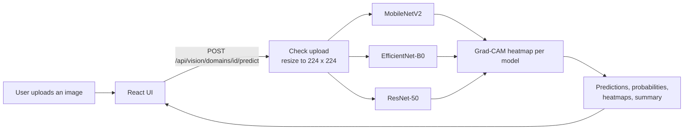
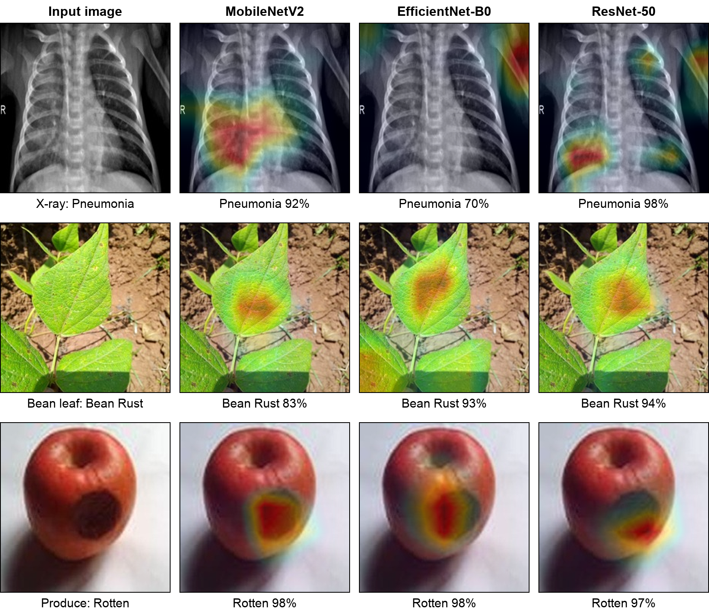
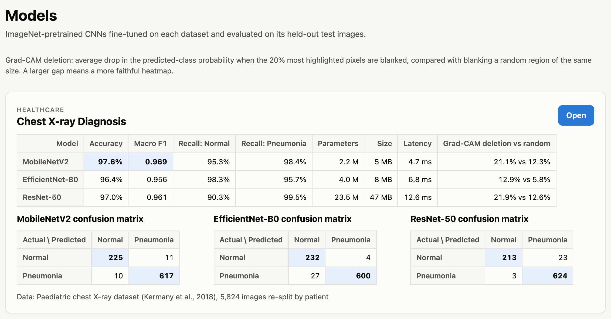

# Explainable AI for Agriculture and Healthcare

Most AI models in medicine and farming give an answer without saying why. This project fine-tunes three ImageNet-pretrained CNNs, **MobileNetV2**, **EfficientNet-B0** and **ResNet-50**, on three image tasks and explains every prediction with a **Grad-CAM** heatmap:

- **Disease diagnosis**: does a chest X-ray show pneumonia?
- **Crop health**: is a bean leaf healthy, or does it have angular leaf spot or bean rust?
- **Food quality**: is a fruit or vegetable fresh or rotten?

You upload an image (or pick a held-out test image) and see all three models' predictions and heatmaps side by side, so you can compare not just what they predict but where they look.


## What it does

| | |
| --- | --- |
| **Predict** | Three fine-tuned CNNs classify the image and return the probability of every class. |
| **Explain** | A Grad-CAM heatmap for each model shows which image regions raised the predicted-class score. |
| **Summarise** | A short summary says whether the models agree and where each one focused. |
| **Compare** | A comparison table shows each model's test accuracy, macro F1, per-class recall, size, speed and heatmap faithfulness. |
| **Validate** | Held-out test images with known labels can be loaded to compare predictions with the truth. |

## How it works



### Grad-CAM

For the predicted class, the gradient of the class score with respect to each feature map of the last convolutional layer (a 7 x 7 grid for all three networks) is averaged into a weight. The heatmap is the ReLU of the weighted sum of the feature maps, enlarged to 224 x 224 and laid over the image (`backend/app/vision/gradcam.py`).

### Checking the heatmaps (deletion test)

A heatmap can look plausible without reflecting what the model uses. For 200 test images per model, the 20% of pixels with the highest heat are blanked and the drop in the predicted-class probability is compared with blanking a random blob of the same size. A faithful heatmap should hurt the prediction more than a random region.

## Datasets

| Domain | Task | Dataset | Classes | Train / val / test |
| --- | --- | --- | --- | --- |
| Healthcare | Pneumonia detection | Paediatric chest X-rays (Kermany et al., 2018), 5,824 images | Normal, Pneumonia | 4,078 / 883 / 863 |
| Agriculture | Bean leaf disease | iBean, Makerere AI Lab, 1,295 field photos | Angular leaf spot, Bean rust, Healthy | 1,034 / 133 / 128 |
| Food | Fresh vs rotten produce | Fruits and vegetables, 12 types, 5,382 images | Fresh, Rotten | 1,500* / 823 / 835 |

Data handling (`python -m app.vision.prepare`):

- **X-rays are split by patient.** The public release shares patients between its train and test folders (278 test patients also appear in training), which would let a model recognise a patient instead of the disease. All images are pooled and re-split 70/15/15 by patient, stratified by class.
- **Duplicates are removed** from the produce dataset (194 found by comparing small thumbnails) before it is split 70/15/15 per source class.
- All images are resized to 224 x 224.

\* To save memory the produce models were trained with `--train-limit 1500`, a class-balanced random subset of the 3,724 training images. Validation and test sets are unchanged.

## Training

`python -m app.vision.train` fine-tunes every model with the same settings: ImageNet weights with a new output layer, AdamW (learning rate 2e-4 for pretrained layers, 1e-3 for the new layer, one-cycle schedule), 8 epochs, batch size 32, random crop, rotation and brightness/contrast (horizontal flip for leaf and produce only), class-weighted cross-entropy with label smoothing 0.05, seed 42. The epoch with the best validation macro F1 is kept and the test set is used once. Runs on the Apple GPU (MPS), CUDA or CPU.

## Results

Held-out test images, measured on an Apple M4. Time is the median for one image (batch of 1). Bold = best macro F1 per task.

| Task | Model | Test accuracy | Macro F1 | Recall per class | Size | Time / image | Grad-CAM deletion drop (highlighted vs random) |
| --- | --- | --- | --- | --- | --- | --- | --- |
| Chest X-ray | **MobileNetV2** | **97.6%** | **0.969** | 95.3 / 98.4 | 4.6 MB | 4.7 ms | 21.1 vs 12.3 pp |
|  | EfficientNet-B0 | 96.4% | 0.956 | 98.3 / 95.7 | 8.2 MB | 6.8 ms | 12.9 vs 5.8 pp |
|  | ResNet-50 | 97.0% | 0.961 | 90.3 / 99.5 | 47.2 MB | 12.6 ms | 21.9 vs 12.6 pp |
| Bean leaf | MobileNetV2 | 96.1% | 0.961 | 93.0 / 97.7 / 97.6 | 4.6 MB | 5.4 ms | 26.9 vs 5.0 pp |
|  | EfficientNet-B0 | 95.3% | 0.953 | 88.4 / 97.7 / 100.0 | 8.2 MB | 15.0 ms | 47.2 vs 31.6 pp |
|  | **ResNet-50** | **96.9%** | **0.969** | 95.3 / 95.3 / 100.0 | 47.2 MB | 26.0 ms | 26.0 vs 8.0 pp |
| Produce freshness | MobileNetV2 | 94.0% | 0.940 | 93.3 / 94.7 | 4.6 MB | 4.9 ms | 27.1 vs 3.3 pp |
|  | EfficientNet-B0 | 94.5% | 0.945 | 93.5 / 95.5 | 8.2 MB | 6.4 ms | 28.8 vs 4.8 pp |
|  | **ResNet-50** | **96.2%** | **0.962** | 96.4 / 95.9 | 47.2 MB | 11.1 ms | 33.2 vs 9.1 pp |

- All nine models reach 94% to 98% test accuracy, so the choice between them rests on size, speed and the kinds of errors that matter.
- MobileNetV2 is about 10x smaller and 2.7x faster than ResNet-50 on X-rays at similar accuracy.
- For every model and task, blanking the Grad-CAM regions hurts the prediction more than blanking random regions.
- The leaf test set has only 128 images, so one image is 0.8 points and small differences between models there are not meaningful. Timings were measured on a shared laptop and are approximate.

| Grad-CAM heatmaps for one test image per task | Model comparison page |
| --- | --- |
|  |  |

## Tech stack

| Layer | Tools |
| --- | --- |
| Models | PyTorch 2.8, torchvision (MobileNetV2, EfficientNet-B0, ResNet-50), Pillow |
| Explainability | Grad-CAM and deletion test (`backend/app/vision/gradcam.py`, `train.py`) |
| Metrics | scikit-learn (accuracy, F1, confusion matrix) |
| API | FastAPI, Uvicorn |
| Frontend | React 18, React Router 6, Vite 6, plain CSS with light and dark themes |
| Testing | pytest, FastAPI TestClient |

## Project structure

```
backend/
  app/
    main.py               FastAPI app and CORS
    api/
      router.py           /api prefix
      routes/             health and image endpoints
    vision/
      domains.py          the three image tasks
      prepare.py          download, de-duplicate, patient-level split, resize
      models.py           MobileNetV2, EfficientNet-B0, ResNet-50 with new heads
      train.py            fine-tune, benchmark, deletion test
      gradcam.py          Grad-CAM and heatmap overlay
      service.py          load models, predict, explain
  tests/test_vision.py
frontend/
  src/
    pages/                Home, Vision (one page per task), Models, NotFound
    components/           Layout, BarList, ConfusionMatrix, VisionComparison, Status
    api.js                API client
docs/screenshots/
```

## Setup

Requirements: Python 3.9+ and Node.js 18+, about 1 GB of free disk for the datasets.

**Backend**

```bash
cd backend
python3 -m venv .venv
source .venv/bin/activate
pip install -r requirements.txt
python -m app.vision.prepare                  # download and prepare images into data/vision/
python -m app.vision.train --epochs 8         # fine-tune and benchmark the 9 models
uvicorn app.main:app --reload --port 8000
```

On a machine with little memory, add `--train-limit 1500` to train on a smaller class-balanced subset.

**Frontend** (in a second terminal)

```bash
cd frontend
npm install
npm run dev
```

Open http://localhost:5173. The Vite dev server forwards `/api` requests to port 8000.

**Tests**

```bash
cd backend
python -m pytest              # 10 tests: every model on real test images, Grad-CAM, uploads, endpoints
```

## Routes

| Page | Path |
| --- | --- |
| Overview | `/` |
| Chest X-ray, bean leaf, produce | `/vision/xray`, `/vision/leaf`, `/vision/fruit` |
| Model comparison | `/models` |

| Method | Endpoint | Returns |
| --- | --- | --- |
| GET | `/api/health` | Status and the trained models per task |
| GET | `/api/vision/domains` | Image tasks with the test metrics of every model |
| GET | `/api/vision/domains/{id}` | Task details and held-out test images |
| GET | `/api/vision/domains/{id}/samples/{name}` | A held-out test image |
| POST | `/api/vision/domains/{id}/predict` | Multipart image upload; returns each model's prediction, probabilities and Grad-CAM heatmap |

Interactive API docs are at http://localhost:8000/docs.

## Limitations

- Each model is trained on one public dataset per task; results on images from other hospitals, farms or cameras are untested.
- Grad-CAM heatmaps are coarse (a 7 x 7 grid) and show where the model looked, not exact boundaries.
- The produce models were trained on a 1,500-image subset because of limited memory.
- This is a research prototype and is not validated for clinical, agricultural or food-safety decisions.

## Roadmap

- Test the models on external datasets and try sharper explanations (Grad-CAM++)
- Train the produce models on the full training set
- Run MobileNetV2 on a phone for offline use in the field
- Evaluate the interface with doctors, agronomists and food inspectors
